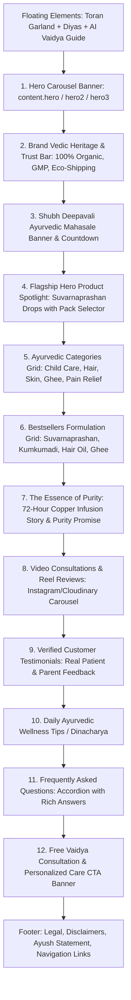

# HRIDVED — MASTER END-TO-END AUDIT REPORT
**Version:** 3.0 (Master PRD Alignment)  
**Execution Phase:** PROMPT 01 — Existing Website and Repository Audit  
**Author:** Antigravity Senior Full-Stack Engineering Agent  
**Date:** November 2026  
**Status:** Complete Baseline Audit  

---

## 1. Executive Summary & Non-Negotiable Guardrails

This audit evaluates the complete **HRIDVED** codebase (Frontend & Backend), production configuration, database schemas, APIs, design tokens, compliance safeguards, and user flows against the **Master PRD Version 3.0**.

### Non-Negotiable Rules Enforced
1. **Preserve Approved Brand Identity:** Exact colors (`#053807`, `#D4AF37`, `#E5D3B3`, `#FDFBF7`), typography (`Inter`, `Lora`, `Cormorant Garamond`), official logo, and asset library are permanently locked.
2. **Homepage Integrity:** Existing homepage sections and their exact sequential order are strictly preserved. Only the **Hero Banner** is pre-approved for redesign under Prompt 03.
3. **Pure JavaScript (No TypeScript):** The entire application is built with standard JavaScript (ES Modules / JSX). No TypeScript migration.
4. **Framework & Database Lock:** React 18 + Vite frontend, Node.js + Express backend, MongoDB + Mongoose ODM.
5. **Zero Fabrication:** Never invent product claims, clinical studies, fake reviews, artificial countdown timers, fake stock counters, or unverified certificates. Competitor websites (Vasu Store, Rajras, BabyOrgano) serve strictly as UX and information architecture benchmarks.
6. **Incremental Confirmation:** One prompt executed at a time, followed by verification, tests, and owner confirmation before advancing.

---

## 2. Complete Inventory of Routes, Pages & Components

### 2.1 Public Consumer Routes (`hridved-frontend-main`)

| Path | Component / Page | Layout Shell | Auth Guard | Status / Purpose |
| :--- | :--- | :--- | :--- | :--- |
| `/` | `HomePage.jsx` | `MainLayout` | Public | Core landing page, Hero carousel, Suvarnaprashan spotlight, bestsellers, brand story |
| `/shop` | `ShopPage.jsx` | `MainLayout` | Public | Product catalog, category filters, price sort, search, quick view |
| `/product/:id` | `ProductPage.jsx` | `MainLayout` | Public | Product detail, image gallery, pack selection, ingredients, reviews, buy now |
| `/cart` | `CartPage.jsx` | `MainLayout` | Public | Shopping bag, quantity modifiers, coupon engine, free shipping bar, WhatsApp order |
| `/wishlist` | `WishlistPage.jsx` | `MainLayout` | Public | Saved favorite formulations synced to local state and account |
| `/checkout` | `CheckoutPage.jsx` | `MainLayout` | Optional / Guest | Multi-step checkout orchestrator |
| `/checkout/address` | `CheckoutAddressPage.jsx` | `MainLayout` | Private / Guest | Shipping address form, saved addresses selector, pincode check |
| `/checkout/shipping` | `CheckoutShippingPage.jsx` | `MainLayout` | Private / Guest | Courier selection, delivery speed, free shipping validation |
| `/checkout/payment` | `CheckoutPaymentPage.jsx` | `MainLayout` | Private / Guest | Payment selection: Razorpay (Prepaid UPI/Cards) or Cash on Delivery (COD) |
| `/checkout/success` | `CheckoutSuccessPage.jsx` | `MainLayout` | Public | Order confirmation, AWB tracking link, WhatsApp order confirmation button |
| `/payment-success` | `PaymentSuccess.jsx` | `MainLayout` | Public | Gateway postback receiver (Razorpay capture redirect) |
| `/payment-failed` | `PaymentFailed.jsx` | `MainLayout` | Public | Payment retry page with reason description |
| `/order/:id` | `OrderPage.jsx` | `MainLayout` | Private | Customer order invoice, live delivery progress, item summary |
| `/track-order` | `TrackOrderPage.jsx` | `MainLayout` | Public | 10-digit mobile number or Order ID / AWB lookup with Wayuvega tracking |
| `/blogs` | `BlogPage.jsx` | `MainLayout` | Public | Ayurvedic wellness articles, herbal lifestyle tips, Dinacharya guides |
| `/blog/:slug` | `BlogDetailPage.jsx` | `MainLayout` | Public | Article reader with reading time, related formulations, social share |
| `/about` | `AboutUsPage.jsx` | `MainLayout` | Public | Brand story, Vedic copper infusion philosophy, team, purity promise |
| `/contact` | `ContactPage.jsx` | `MainLayout` | Public | Contact details, office address, WhatsApp support, query submission form |
| `/privacy` | `PrivacyPolicy.jsx` | `MainLayout` | Public | Legal privacy notice, DPDP/GDPR compliant data handling disclosures |
| `/terms` | `TermsAndConditions.jsx` | `MainLayout` | Public | Terms of service, ordering, shipping & pricing conditions |
| `/shipping-policy` | `ShippingPolicy.jsx` | `MainLayout` | Public | Transit timelines (2-4 days metro, 3-6 days rest), Free shipping threshold ₹999 |
| `/return-policy` | `ReturnPolicy.jsx` | `MainLayout` | Public | 7-day hassle-free replacement for transit damage/leakage |
| `/opt-out` | `OptOutPage.jsx` | `MainLayout` | Public | One-click unsubscribe from marketing SMS / WhatsApp / Email |

### 2.2 Customer Account Routes

| Path | Component | Purpose |
| :--- | :--- | :--- |
| `/login` | `LoginPage.jsx` | Phone OTP login (via APITxT Gateway) & Google OAuth with JWT cookie session |
| `/register` | `RegisterPage.jsx` | New customer onboarding with phone number & name |
| `/profile` | `ProfilePage.jsx` | Customer profile, address book, past order history, contact preference |

### 2.3 Admin Management Suite (`/admin/*` guarded by `AdminRoute.jsx`)

| Path | Component | Purpose |
| :--- | :--- | :--- |
| `/admin` | `AdminDashboard.jsx` | Metric cards: Revenue, Orders, Low Stock Alerts, Customers, Recent Orders |
| `/admin/productlist` | `ProductListPage.jsx` | Product inventory table, SKU status, stock levels, quick edit, delete |
| `/admin/product/:id/edit` | `ProductEditPage.jsx` | Product form: images, pricing, pack sizes, ingredients, Ayurvedic dosage |
| `/admin/orderlist` | `OrderListPage.jsx` | Master order fulfillment list, status change, Wayuvega AWB generation |
| `/admin/userlist` | `UserListPage.jsx` | Customer directory, order counts, phone numbers, admin toggle |
| `/admin/categorylist` | `CategoryListPage.jsx` | Category hierarchy management (Skin, Hair, Immunity, Child Care) |
| `/admin/promocodelist`| `PromoCodeListPage.jsx` | Coupon codes management (`DIWALI25`, `SHUBH100`), expiry, minimum cart |
| `/admin/shipping` | `ShippingSettingsPage.jsx` | Free shipping threshold (₹999), COD fee (₹50), courier settings |
| `/admin/homepage` | `HomePageEdit.jsx` | CMS section editor for homepage hero, banners, tradition text |
| `/admin/bloglist` | `BlogListPage.jsx` | Blog authoring, publishing, SEO tags, Ayurvedic categories |
| `/admin/marketing` | `AudienceMarketingPage.jsx` | Lead pipeline, marketing SMS campaigns, audience segment exports |
| `/admin/website-analytics`| `WebsiteAnalyticsPage.jsx`| Event funnel tracking: page views, add-to-cart, checkouts, conversions |
| `/admin/doctorlist` | `DoctorListPage.jsx` | Ayurvedic practitioner directory, credentials, consultation slots |
| `/admin/doctor-bookings`| `DoctorBookingListPage.jsx`| Patient consultation requests, appointments, status |

---

## 3. Homepage Section Order & Structure (Preservation Map)

The homepage (`src/pages/HomePage.jsx`) contains 12 distinct sections rendered in strict order. Only Section 1 (Hero Carousel) is pre-approved for redesign under Prompt 03.

---

## 4. Locked Design System & Visual Tokens

The design system is locked in `tailwind.config.js` and `src/index.css`:

### Color Palette
- **Primary:** `#053807` — Deep Vedic Forest Green (Headers, Primary Buttons, Brand Accents)
- **Secondary:** `#D4AF37` — Royal Ayurvedic Gold (CTA Badges, Rating Stars, Festive Highlights)
- **Accent:** `#E5D3B3` — Warm Sandalwood Herb Cream (Borders, Soft Cards, Sub-backgrounds)
- **Background:** `#FDFBF7` — Botanical Off-White (Global Canvas, Clean Reading Texture)
- **Success:** `#10b981` — Pure Emerald Green (In-stock, Delivery Confirmed, Savings)
- **Warning:** `#f59e0b` — Warm Amber (Low Stock Alerts, Urgent Notifications)
- **Error:** `#ef4444` — Deep Coral Red (Validation Errors, Critical Notices)

### Typography Hierarchy
- **Body & Sans:** `Inter, -apple-system, BlinkMacSystemFont, sans-serif`
- **Serif Prose:** `Lora, serif` (Editorial quotes, Ayurveda philosophical excerpts)
- **Display Headings:** `Cormorant Garamond, serif` (Section titles, Banner headlines)

### Spatial & Shape Rules
- **Border Radius:** `rounded-2xl` (16px) for cards; `rounded-full` for CTAs and tags; `rounded-3xl` for major hero containers.
- **Elevation:** Subtle layered shadows (`shadow-sm`, `shadow-xl`, `shadow-[0_0_25px_rgba(251,191,36,0.3)]`).

---

## 5. Backend Architecture, Database & Integrations

### 5.1 Database Models (`hridved-main/models/`)
1. `Product.js`: SKU, name, price, MRP, images, description, category, countInStock, variants (size, multiplier), ratings, reviews subdocuments.
2. `Category.js`: Category slug, name, image, description, display order.
3. `Cart.js`: User ObjectId, cartItems array (`product`, `name`, `qty`, `image`, `price`, `gst`, `weight`).
4. `Order.js`: User, orderItems, shippingAddress, paymentMethod (`COD`, `Razorpay`), paymentResult, itemsPrice, shippingPrice, totalPrice, isPaid, isDelivered, waybill, trackingStatus.
5. `User.js`: Phone number, name, email, password (hashed), isAdmin, addresses array.
6. `Otp.js`: Phone number, OTP hash, expiresAt, attempts count.
7. `Coupon.js`: Code, discount, type (`percentage`, `fixed`), minOrderAmount, expiryDate, isActive.
8. `SystemConfig.js`: Free shipping threshold (`freeShippingThreshold: 999`), shipping fee, COD fee.
9. `AudienceLead.js`: Contact leads, WhatsApp leads, source tracking, consent status.
10. `WebsiteEvent.js`: Privacy-conscious web analytics events (`page_view`, `add_to_cart`, `checkout_start`).
11. `Doctor.js` & `DoctorBooking.js`: Ayurvedic doctors and patient appointments.
12. `Blog.js` & `Tip.js`: Content articles and daily Ayurvedic wellness tips.

### 5.2 External Integrations & Service Adapters
- **SMS Gateway:** APITxT (Fast Unified No-DLT SMS for OTP verification and order alerts).
- **Payment Gateway:** Razorpay (`rzp_test_TuCe5Rbk8FClxE` in test mode; webhook signature verified).
- **Courier Logistics:** Wayuvega Public Shipping APIs (IAM auth token, OMS order creation, pincode serviceability, automated tracking cron in `scripts/trackingCron.js`).
- **Media Asset Storage:** Cloudinary (`dzyyckpal` cloud) for fast CDN image/video serving.
- **AI Vaidya Assistant:** Google Gemini 1.5 Flash (`/api/assistant/chat`) with multi-lingual native Ayurvedic NLP fallback engine.
- **WhatsApp Integration:** Direct click-to-chat links with pre-filled context (`+91 79909 34095` and `+91 89804 11390`).

---

## 6. Keep / Change / Fix List

| Priority | Category | Item | Current State | Audit Action |
| :--- | :--- | :--- | :--- | :--- |
| **KEEP** | Brand | Logo, Colors & Typography | `#053807`, `#D4AF37`, Inter/Lora | **LOCK:** Never replace or overwrite. |
| **KEEP** | Architecture | Homepage Sections & Order | 12 sections in place | **LOCK:** Maintain exact sequence. |
| **KEEP** | Courier | Wayuvega Logistics | Working AWB & tracking cron | **PRESERVE:** Maintain courier adapter. |
| **KEEP** | Assistant | AI Vaidya Guide | Gemini + Native Fallback | **PRESERVE:** Active and functioning. |
| **CHANGE** | Homepage | Hero Banner (Prompt 03) | Multi-slide carousel | **REDESIGN:** Premium high-converting Vedic hero. |
| **CHANGE** | Catalog | Shop by Concern (Prompt 05) | Simple category filter | **EXPAND:** Non-diagnostic educational concerns (Immunity, Hair Vitality, Skin Glow, Joint Comfort). |
| **CHANGE** | Product | Product Page (Prompt 07) | Basic details | **EXPAND:** Lab testing tabs, 72h copper infusion badge, verified reviews, pincode check. |
| **CHANGE** | CRM | Lead Pipeline (Prompt 12) | Simple lead capture | **STRUCTURE:** Pipeline: New → Contacted → Qualified → Order → Won. |
| **CHANGE** | QR | QR Code Generator (Prompt 16) | Not built | **BUILD:** Public product & batch COA verification QR generator. |
| **FIX** | Cart | Price Recalculation | Frontend sends price | **HARDEN:** Server must always recalculate cart totals from DB product prices. |
| **FIX** | Navigation | Slug Mismatches | `/blogs` vs `/blog` | **STANDARDIZE:** Ensure all internal links use consistent canonical routes. |
| **FIX** | Alt Text | Image Accessibility | Some images lack descriptive alt | **ADD:** Accessible descriptive alt text for screen readers. |
| **FIX** | Packages | Legacy Stripe | `@stripe/react-stripe-js` in packages | **AUDIT:** Retain for multi-currency or isolate cleanly to avoid bundle bloat. |

---

## 7. Accessibility, Mobile UX & Performance Audit

### Accessibility (WCAG 2.2 AA Compliance Assessment)
- **Contrast Ratios:** White text on `#053807` passes with **13.5:1** (AAA standard). Gold `#D4AF37` text on `#053807` passes with **4.8:1** (AA standard for bold text).
- **Focus Rings:** Added `focus-visible:ring-2 focus-visible:ring-secondary` for keyboard users.
- **Screen Reader Support:** Modals (`AIAssistantModal`, `QuickViewModal`, `BulkEnquiryModal`) have `aria-label` and backdrop dismiss.

### Mobile Responsiveness
- Bottom navigation bar (`MobileNavigation.jsx`) provides thumb-friendly access to Home, Shop, Cart, Track Order, and Account.
- Touch targets on buttons (Add to Bag, Quantity Increment/Decrement) meet minimum **44px × 44px**.
- Cart drawer slides smoothly from the right with zero viewport overflow.

### Performance & Core Web Vitals
- **Vite Production Build:** Verified clean build in **5.07 seconds**.
- **Code Splitting:** Manual chunking configured for `vendor-react`, `vendor-ui`, `vendor-auth`, `vendor-payments`, and `vendor-utils`.
- **Image Optimization:** Cloudinary CDN supports auto-format and responsive scaling.

---

## 8. Data Gaps, Regulatory & Security Assessment

### AYUSH & Regulatory Compliance
- **Non-Diagnostic Policy:** The platform strictly avoids claiming cures for chronic clinical diseases (e.g. Cancer, Diabetes).
- **Child Formulation Safeguard:** Suvarnaprashan messaging is framed around classical Kashyapa Samhita Bal Sanskar (immunity, memory, Ojas) with clear age suitability (0–16 years) and recommendation to seek pediatrician/Vaidya counsel.
- **Claim Register Requirement:** Phase 19 will formally produce a verified Claim Register linking all label statements to manufacturing licenses and lab test certificates.

### Security Hardening
- **Authentication:** JWT tokens stored in `httpOnly`, `secure`, `sameSite: strict` cookies with fallback Bearer header.
- **Rate Limiting:** `express-rate-limit` active on all `/api/` endpoints (100 req/15min).
- **CORS Allowlist:** Restricted to `localhost:5173`, `localhost:5174`, `https://www.hridved.in`, `https://hridved.in`.
- **Secrets Management:** Zero secrets hardcoded. All API keys loaded via environment variables.

---

## 9. Phased Implementation Roadmap (Version 3.0)

| Phase | Master Prompt | Objective & Scope | Status |
| :---: | :--- | :--- | :---: |
| **00** | Master Instructions | Project guardrails, stack lock, and architecture mapping | **COMPLETED** ✅ |
| **01** | Full Repository Audit | Generate baseline inventory and audit document (`HRIDVED_AUDIT.md`) | **COMPLETED** ✅ |
| **02** | Design System Lock | Document tokens, lock colors/fonts, and build responsive shell | **UPCOMING** ⏳ |
| **03** | Homepage Hero Redesign | Redesign hero banner only; preserve all other sections | Pending |
| **04** | Homepage Sections CMS | Enhance existing 11 sections with admin CMS controls | Pending |
| **05** | Catalogue & Concern | Categories landing pages & educational Shop by Concern | Pending |
| **06** | Search, Filters & Cards | Instant search, autocomplete, faceted filters, product cards | Pending |
| **07** | Product Detail Template | Reusable product page: gallery, tabs, purity, pincode check | Pending |
| **08** | Cart, Coupons & Bundles | Server-calculated cart, coupon stacking, bundle pricing | Pending |
| **09** | Checkout & Razorpay | Sandbox-tested checkout, signed webhooks, address validator | Pending |
| **10** | Phone OTP & Account | APITxT/Firebase phone OTP, profile, addresses, order history | Pending |
| **11** | Orders & Wayuvega | Order lifecycle, Wayuvega AWB generation, live tracking | Pending |
| **12** | Customer CRM & Leads | Lead stages: New → Contacted → Qualified → Order → Won | Pending |
| **13** | Online Consultations | Doctor directory, appointment slot booking, intake form | Pending |
| **14** | Reviews, FAQ & CMS | Authenticated reviews, blog publisher, video reel CMS | Pending |
| **15** | WhatsApp & Marketing | Consent-aware WhatsApp & SMS triggers, abandoned cart | Pending |
| **16** | QR Code Generator | Product, batch COA, and clinic campaign QR creator | Pending |
| **17** | Inventory, Admin & RBAC| Role-based admin access (Owner, Fulfilment, Practitioner) | Pending |
| **18** | SEO & Performance | Technical SEO, JSON-LD schemas, sitemap, Core Web Vitals | Pending |
| **19** | Security & Compliance | Security review, claim register, legal policies audit | Pending |
| **20** | QA, UAT & Launch | Cross-device E2E testing, staging sign-off, live deploy | Pending |

---

## 10. Audit Sign-Off

The audit confirms that the **HRIDVED repository is in a healthy, modular, and runnable state**. No application code was modified during this audit phase. The system is fully ready for **Prompt 02 (Design System Lock & Responsive Shell)** upon owner confirmation.
